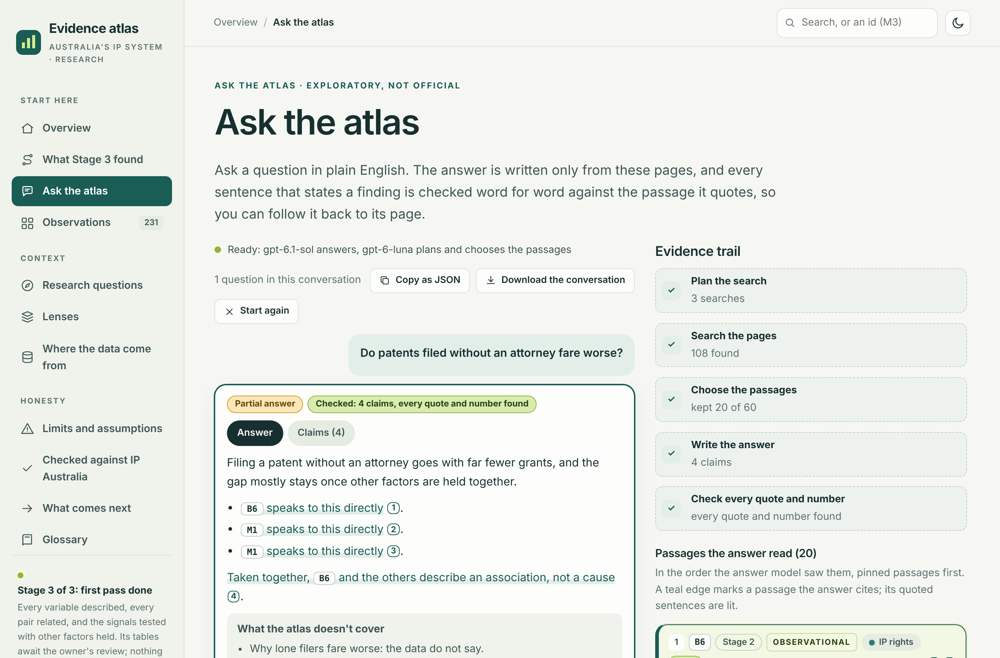
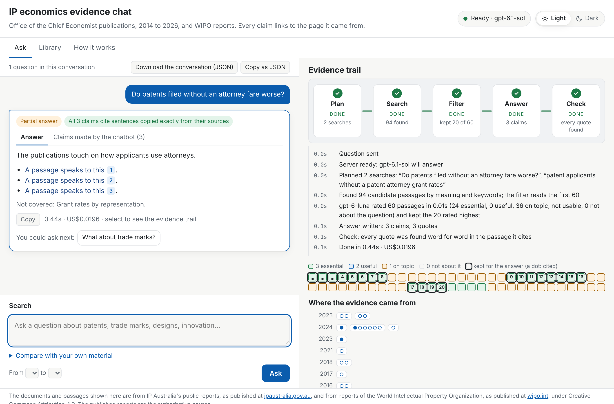
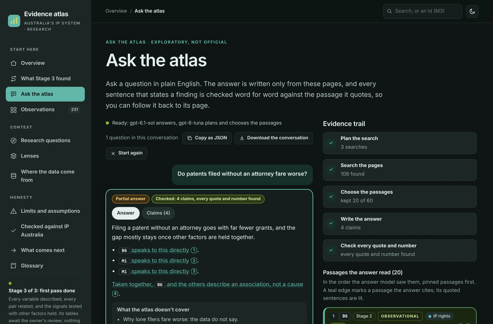

# The atlas chat: smoke test (not run) and the page side by side (atlas-chat-v1)

**Status, 4 November 2026: the smoke test could not run.** OpenAI refused the key this cloud session's environment
injects for `api.openai.com`: the first call returned HTTP 401 with the code `expired_secret_key`. The owner has since
confirmed that this key has no credit left, and that the chatbot's own key, on Render, is fine (corrected 4 November
2026: this report first said the key "has expired", reading the error code alone). Nothing was spent (the ledger is
unchanged; the budget for this test, D-037's US$2.00, is untouched). The runner now stops at the first refused call
(`manifests/atlas-smoke/`, the second run is recorded as failed). With a funded key in the environment, run in a new
session:

```sh
OPENAI_API_KEY=<placeholder behind the proxy> ECON_ENVIRONMENT=eval uv run econ atlas-smoke --confirm
```

It sends 20 of `eval/atlas/atlas-v1.jsonl`'s needs (7 lookups, 3 by id, 5 exploratory, all 5 out of scope) through the
full pipeline with the service's models, meters every call in `eval/spend/ledger.jsonl`, stops itself at US$2.00
(US$0.25 reserved a question), and writes `eval/runs/atlas-smoke-v1/` (every event, and a summary per need: the
outcome, attempts, numbers-check errors, the gold observation cited or not, coverage, cost and seconds). This report
is then completed with that table, every answer read for causes stated from associations, and a recommendation on
adopting atlas-plan-v1, atlas-filter-v1 and atlas-answer-v1 (decision 5). Until then the prompts are written and locked
but not adopted by the owner, and nothing is published.

## What was checked without a model

- **Retrieval** (`reports/retrieval-atlas-v1.md`): every lookup and by-id need reaches its gold pages in the 20
  passages the answer would read; the free settings were adopted from it (D-038).
- **The pipeline with a scripted model** (`tests/test_atlas.py`): the atlas's own prompts load and are sent; ids in the
  question pin their observation's passages first; an answer whose number is not in its cited sentence goes back once
  and is then flagged; the routes are kept apart both ways.
- **The page against this API, locally, in evidence-only mode**: the page woke `/api/atlas/health`, sent
  `observations: ["B6"]` from "Ask about this observation", and B6's own passages came back first, pinned; no console
  errors.
- **The page in Chromium** (`analysis/atlas/chat_check.mjs` in the atlas repository): against a provisional event
  stream, made by the real search, filter order and pins over this index with a scripted plan, ratings and answer, every
  check passes at 1,366 and 390 pixels: the answer and its cited runs render, every claim's quote is lit in the trail, a
  claim focuses its passage, ids link to their pages, the claims tab, Copy, the JSON export (`atlas-chat-export/1`,
  without passage text), a follow-up asks again, the conversation survives a visit to a cited page, no horizontal
  overflow, and a clean console. The smoke test's recorded stream replaces the provisional one.

## The two chats side by side (1,366 pixels)

Siblings in method (the steps, the cited prose, the claims, the trail of passages) and different in look: the atlas
chat sits in the atlas's shell and draws its passages as atlas cards with their observation, stage, strength, lens and
Stage 3 outcome, in the atlas's teal; the Econ chat keeps its own page, navy and tiles.

| The atlas chat | The Econ chat |
|---|---|
|  |  |

The atlas chat in dark mode: 

Both are drawn from scripted answers (not model output), to show the layout only.

## Memory on Render's free plan

`econ serve` locally, after one question to each chat: 195 MB resident with both indexes, 146 MB with Econ's alone,
well under the 512 MB plan (the plan's ceiling was about 400 MB).
